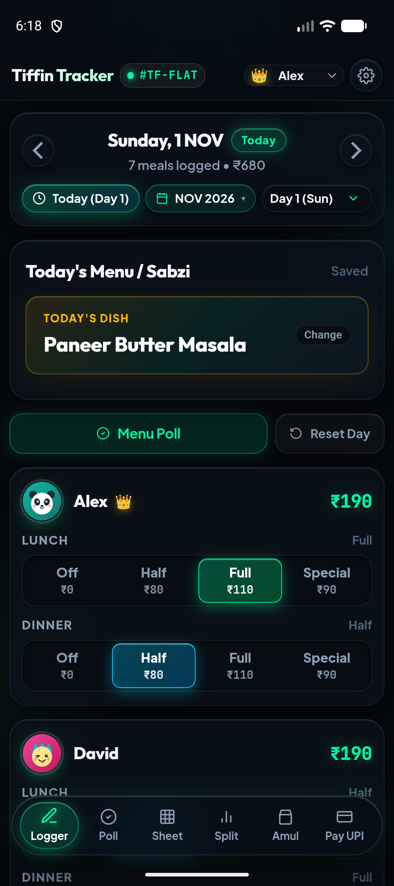
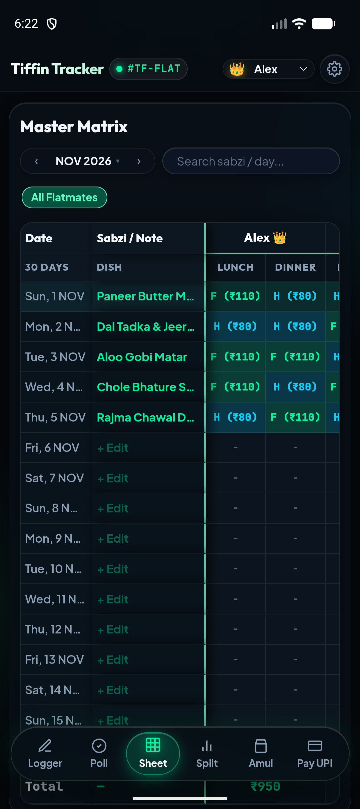
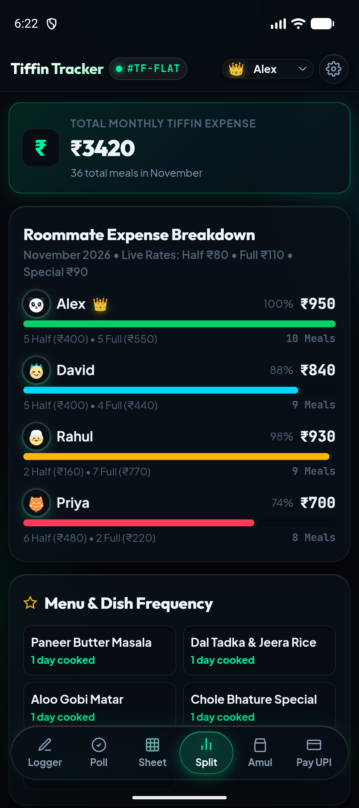
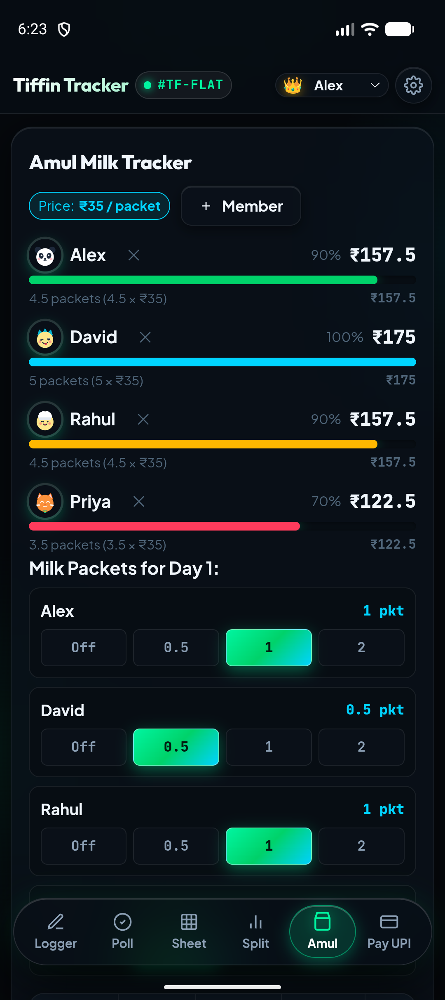
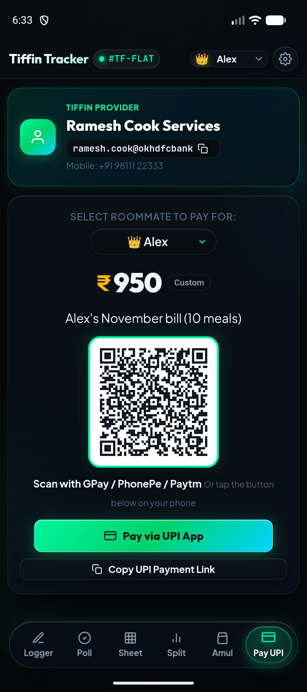
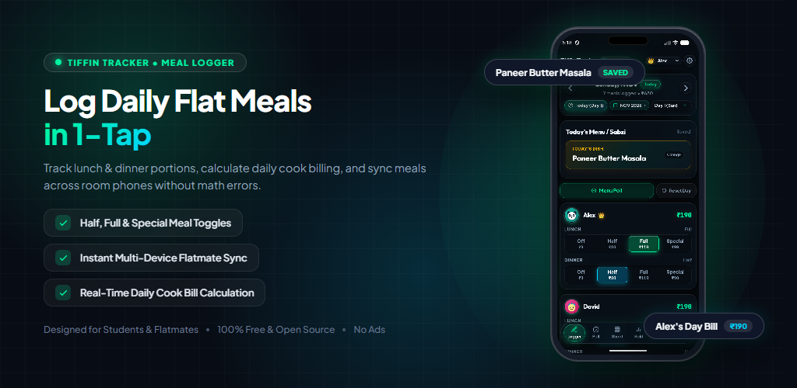

<div align="center">
  
  <h1>🍱 Tiffin Tracker</h1>
  <p><strong>The modern, real-time shared mess and tiffin expense manager built for flatmates, hostels, and PG residents.</strong></p>

  <p>
    <a href="https://github.com/anjanpatel2010/Tiffin-Tracker"></a>
    <a href="https://github.com/anjanpatel2010/Tiffin-Tracker"></a>
    <a href="https://github.com/anjanpatel2010/Tiffin-Tracker"></a>
    <a href="https://github.com/anjanpatel2010/Tiffin-Tracker"></a>
  </p>

  <p>
    <a href="#-download--installation"><strong>📥 Download Latest APK</strong></a> •
    <a href="#-key-features"><strong>✨ Key Features</strong></a> •
    <a href="#-screenshots"><strong>📱 Screenshots</strong></a> •
    <a href="#-how-it-works"><strong>🚀 How It Works</strong></a>
  </p>
</div>

---

## 📌 The Problem It Solves

Living in a shared flat, PG, or hostel in India with a daily mess or tiffin service always creates month-end confusion and awkward billing disputes:
- *“Did you eat dinner on the 14th when you stayed late at the office?”*
- *“Who had the tiffin when a roommate went home for the weekend?”*
- *“How much do we owe the cook, and who pays how much?”*
- *“Who consumed how many packets of Amul milk this month?”*

Paper registers get lost, manual spreadsheets on phones are clumsy, and generic expense-split apps don't handle recurring **Lunch (Half/Full/Special)**, **Dinner**, and **Milk Packets**.

**Tiffin Tracker** solves this completely with a dedicated, zero-friction Android app that keeps all flatmates synchronized in real-time.

---

## 📱 Screenshots

<div align="center">
  <table>
    <tr>
      <td align="center" width="33%">
        <br />
        <b>1-Tap Daily Meal Logger</b><br />
        <sub>Half, Full, Special, Off portion toggles with same-day lock protection</sub>
      </td>
      <td align="center" width="33%">
        <br />
        <b>Master Attendance Sheet</b><br />
        <sub>Zero-flicker matrix showing the whole month's meals at a glance</sub>
      </td>
      <td align="center" width="33%">
        <br />
        <b>Split & Analytics</b><br />
        <sub>Relative contribution bars and dish popularity counter</sub>
      </td>
    </tr>
    <tr>
      <td align="center" width="33%">
        <br />
        <b>Amul Milk Tracker</b><br />
        <sub>Daily packet counter (0.5, 1, 2 pkts) with automatic bill calculations</sub>
      </td>
      <td align="center" width="33%">
        <br />
        <b>Direct UPI Settlements</b><br />
        <sub>Dynamic QR code & 1-tap UPI deep links to pay the cook directly</sub>
      </td>
      <td align="center" width="33%">
        <br />
        <b>Flatmate Cloud Sync</b><br />
        <sub>Instant multi-device sync via 4-digit room code</sub>
      </td>
    </tr>
  </table>
</div>

---

## ✨ Key Features

### 1. 🔒 Same-Day Meal Logging & Daily Lock Protection
- Flatmates can log or change their meals (**Half**, **Full**, **Special**, **Off**) on the **same day only**.
- Once the day has passed, records automatically lock to prevent back-dated alterations and billing disputes.
- Only the **Flat Admin** can unlock and edit past meals using the verified **Admin Security PIN**.

### 2. ⚡ Real-Time Multi-Device Cloud Sync
- Single source of truth powered by **Google Cloud Firestore**.
- When one flatmate logs a meal or records a dish, all other devices in the flat update instantly without manual refreshing.
- Quick flat sharing with an easy-to-remember **4-digit Room Code**.

### 3. 📊 Zero-Flicker Master Matrix Sheet
- Full-month calendar grid with sticky dates, daily dish names, individual meal icons, and total flat expenditure.
- Signature-cached atomic rendering guarantees a silky smooth 60 FPS mobile experience.

### 4. 🥛 Dedicated Amul Milk Tracker
- Separate ledger specifically designed for daily pouch milk tracking.
- Cycle through **Off**, **0.5**, **1**, and **2** packets with a single tap.
- Live calculation of monthly consumption and exact individual dues.

### 5. 💳 Direct Cook UPI Settlements
- Configure your cook/caterer's UPI ID, phone number, and meal rates.
- Generates **dynamic UPI deep links** (compatible with Google Pay, PhonePe, Paytm, and BHIM) and auto-generated **QR Codes**.
- Automatically inserts the roommate's name and month in the UPI transaction note for easy payment tracking.

### 6. 💬 WhatsApp Monthly Summary Formatter
- 1-tap formatted itemized text statement ready to post directly into your flat's WhatsApp group.
- Details each roommate's meal count, tiffin cost, milk total, and final payable amount.

### 7. 👑 Strict Admin Authority & Security
- Protected by a dedicated **Admin Security PIN**.
- Regular roommates joining with room code enter strictly as members and cannot adopt admin privileges.
- Admin has exclusive rights to kick members, adjust rates, reset months, and override locked records.

---

## 📥 Download & Installation

The latest standalone Android APK is hosted directly in this repository:

👉 **[Download Latest APK (Tiffin Tracker)](https://github.com/anjanpatel2010/Tiffin-Tracker/raw/master/Tiffin-Tracker-v5.8.4.apk)**

### Installation Instructions:
1. Download the `.apk` file directly on your Android phone.
2. Tap the downloaded file. When prompted, select **Allow from this source** to enable sideloading.
3. Tap **Install** and open the app!

---

## 🚀 How It Works (Quick Setup)

```
+--------------------------------------------------------------+
| 1. Admin creates flat room -> Sets Admin PIN & 4-digit Code |
+--------------------------------------------------------------+
                               |
                               v
+--------------------------------------------------------------+
| 2. Configure Cook Rates (Half, Full, Special, Milk Packet)   |
+--------------------------------------------------------------+
                               |
                               v
+--------------------------------------------------------------+
| 3. Share 4-digit Room Code with Flatmates on WhatsApp        |
+--------------------------------------------------------------+
                               |
                               v
+--------------------------------------------------------------+
| 4. Flatmates enter room instantly & log meals in real-time   |
+--------------------------------------------------------------+
                               |
                               v
+--------------------------------------------------------------+
| 5. Month-End: Settle directly via UPI & copy WhatsApp bill   |
+--------------------------------------------------------------+
```

---

## 🛠 Technology Stack

- **Frontend:** Pure Vanilla JavaScript (ES6+), Modern CSS3 Glassmorphism with Obsidian & Emerald luxury palette.
- **Mobile Container:** [Capacitor 8](https://capacitorjs.com/) (Native Android bridge, Haptics, Local Notifications, Status Bar).
- **Cloud Backend:** Google Cloud Firestore (Real-time snapshot listeners, offline persistence).
- **Push Messaging:** Firebase Cloud Messaging (FCM HTTP v1).
- **Build Pipeline:** Automated Gradle release pipeline with semantic versioning.

---

## 📄 License

This project is licensed under the [MIT License](LICENSE).
Feel free to fork, customize for your flat, and contribute!
