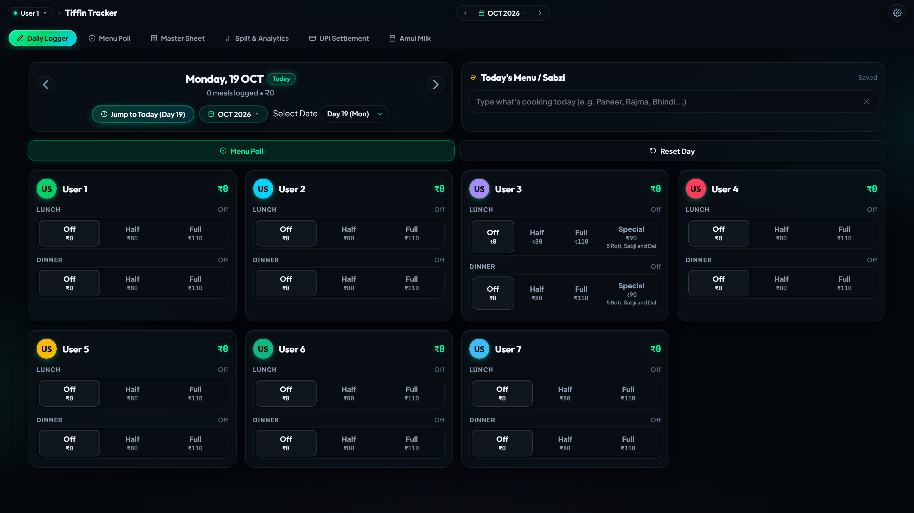
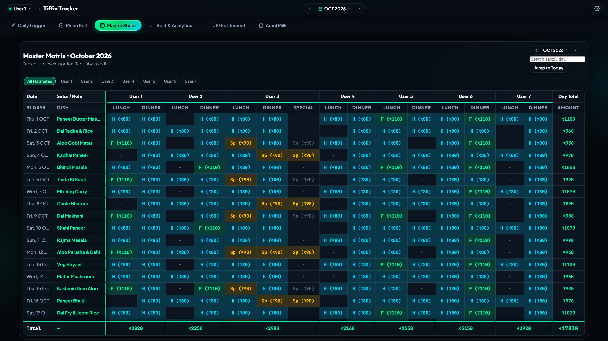
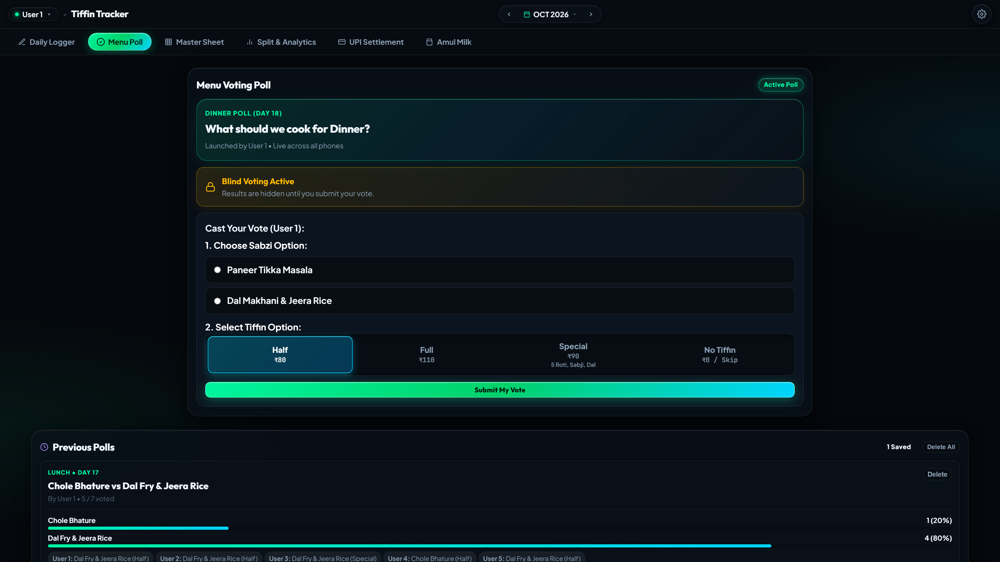
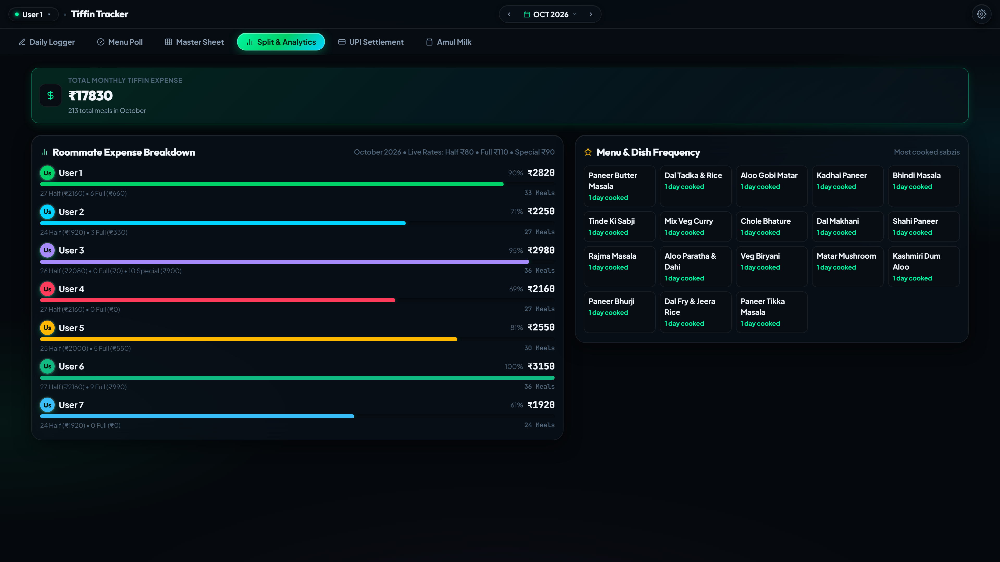
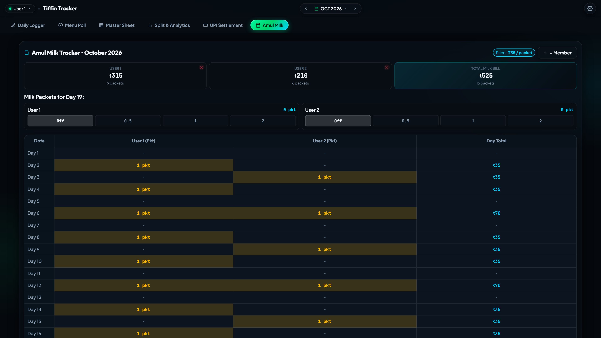
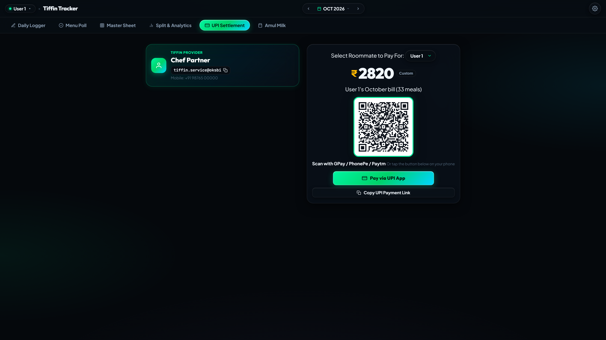

# 🍱 Tiffin Tracker

> **The modern mess & tiffin expense tracker built for roommates, bachelors, and flat groups.**  
> 1-tap meal logging, master spreadsheets, WhatsApp menu polls, dedicated milk tracking, and dynamic UPI settlements — with **₹0 server costs**.

[](LICENSE)
[](manifest.json)
[](#architecture)
[](#technology-stack)

---

## 📌 The Problem

If you live in a shared flat, PG, or hostel and order tiffins daily, you know the month-end nightmare:
- *“Did you eat dinner on the 12th?”*
- *“Who had the tiffin when Alok was out of town?”*
- *“Wait, how much was the total bill, and how do we split it fairly with the cook?”*
- *“Who drank how many packets of Amul milk this month?”*

Spreadsheets are clumsy on phones, Splitwise isn't tailored for daily recurring meals, and manual diaries lead to arguments. 

**Tiffin Tracker** solves this completely. It brings the precision of a software spreadsheet into a lightning-fast, mobile-first PWA that everyone in your flat shares live.

---

## ✨ Key Features

### 1. 🍱 1-Tap Daily Meal Logging
- Switch days effortlessly and log **Lunch** and **Dinner** for all roommates in seconds.
- Supports custom meal types: **Off**, **Full**, and **Special Diet** (e.g. roti + dal preferences).
- Live daily counter showing active meals and today's vegetable/menu.

### 2. 📊 Visual Master Spreadsheet
- Full calendar month overview with per-roommate breakfast, lunch, and dinner status.
- **Sabji Search:** Instantly search through dish history (e.g., find every day you had *Paneer* or *Bhindi*).
- Live month-to-date calculation of total tiffins consumed and individual balances.

### 3. 🗳️ Daily WhatsApp Menu Poll
- When your cook gives today's menu options, launch a quick poll inside the app.
- Flatmates tap to vote directly from their phones.
- **1-Click WhatsApp Order:** Formats the final headcount and dish votes into a clean message ready to send to your tiffin vendor.

### 4. 🥛 Dedicated Amul Milk Tracker
- Shared milk consumption tracked separately from meal bills.
- Custom milk member list, per-packet rate configuration (₹35 default), and monthly trend analytics.
- Roommate contribution breakdown to settle dairy costs fairly.

### 5. 💳 Dynamic UPI Settlement & Invoicing
- Generates live, payable UPI payment links and dynamic QR codes for the tiffin provider (payee).
- Download printable PDF invoices or export Excel/CSV sheets for permanent records.
- 1-tap WhatsApp summary message with exact per-person breakdown.

### 6. 🔒 Month-Scoped Rate Snapshots
- Tiffin provider changes rates? No problem.
- Rates for each month (Half, Full, Special, Milk) are snapshotted to that month's ledger. Changing next month's prices will **never** alter or corrupt past billing records.

### 7. 🛡️ Software-Grade Settings & Audit Trail
- Desktop software preferences window with dedicated left categories: *Pricing Rates*, *Provider Details*, *Profile*, *Share & Export*, *Activity Log*, and *Danger Zone*.
- Full activity log tracking who logged, modified, or reset ledger entries.
- Hard reset protected by an administrative security gate.

---

## 📸 Screenshots

| Daily Logger | Master Sheet |
| :---: | :---: |
|  |  |

| WhatsApp Menu Poll | Split & Balance Analytics |
| :---: | :---: |
|  |  |

| Amul Milk Tracker | Dynamic UPI Settlement |
| :---: | :---: |
|  |  |

---

## 🛠️ Technology Stack

- **Frontend:** Vanilla JavaScript (ES6+), HTML5 Semantic Structure, Custom CSS Design System (no heavy frameworks, zero bloat, instant 60fps mobile performance).
- **Offline / PWA:** Service Worker caching (`sw.js`), Web App Manifest (`manifest.json`), installable on iOS and Android homescreens.
- **Data Persistence & Sync:** Local-first ledger storage with multi-device room synchronization.
- **Hosting:** Static CDN (GitHub Pages, Vercel, or Cloudflare Pages) — **₹0/month forever**.

---

## 🚀 Quick Start (Local Setup)

You don't need `npm install` or complex build pipelines to run Tiffin Tracker. It is built to run instantly anywhere.

1. **Clone the repository:**
   ```bash
   git clone https://github.com/anjanpatel2010/Tiffin-Tracker.git
   cd Tiffin-Tracker
   ```

2. **Serve locally:**
   Using Python:
   ```bash
   python -m http.server 8080
   ```
   Or using Node (`npx serve`):
   ```bash
   npx serve .
   ```

3. **Open in browser:**
   Visit `http://localhost:8080` in your browser.

---

## 📖 Documentation

- 📐 **[ARCHITECTURE.md](ARCHITECTURE.md)** — Architectural design, offline sync model, data schema, and security.
- 🚀 **[DEPLOY.md](DEPLOY.md)** — Step-by-step guide to deploy your own instance to Vercel, Cloudflare, or GitHub Pages.
- 🤝 **[CONTRIBUTING.md](CONTRIBUTING.md)** — Development guidelines, bug reporting, and contribution workflow.

---

## 📄 License

Distributed under the MIT License. See [LICENSE](LICENSE) for more information.

---

## 👨‍💻 Author

**Anjan Patel**  
- GitHub: [@anjanpatel2010](https://github.com/anjanpatel2010)
- Project: [Tiffin Tracker](https://github.com/anjanpatel2010/Tiffin-Tracker)
